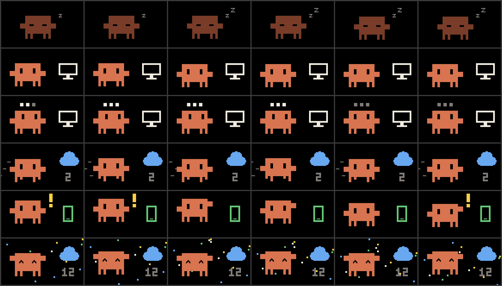

# claude-hud

Um visor de mesa que mostra o que o Claude Code está fazendo. Um bonequinho
laranja dorme, pensa, corre, pede atenção e comemora conforme o estado das
sessões abertas.



De cima para baixo: dormindo, parado, pensando, trabalhando, esperando você e
terminou. O ícone à direita diz de onde vem a sessão (PC, nuvem ou celular) e o
número, quantas sessões estão abertas.

## Hardware

- ESP32-C3 com USB nativo (USB-Serial/JTAG)
- Visor ST7735 de 96x54, SPI de 4 fios, sem CS nem RST ligados

| Sinal | GPIO |
| ----- | ---- |
| SCL   | 6    |
| SDA   | 5    |
| D/C   | 7    |

Pinos e calibração do recorte visível ficam em `src/config.h`.

Sem CS, o visor não tem como retomar o alinhamento dos bytes. Se a imagem
congelar, desligue a placa da energia por alguns segundos e ligue de novo.

## Como funciona

O Claude Code dispara hooks a cada mudança de estado. Cada hook chama
`host/claude-hud-hook`, que escreve uma linha na serial USB da placa:

```
<origem> <estado> [id]
```

- `origem`: `pc`, `cloud` ou `phone`
- `estado`: `start`, `idle`, `thinking`, `working`, `waiting`, `done` ou `end`
- `id`: identificador da sessão, até 11 caracteres

A placa guarda até 8 sessões e mostra a mais urgente: esperando você, depois
trabalhando, pensando, terminou e parado. Uma sessão sem eventos há 30 minutos
é descartada.

| Hook do Claude Code              | Estado     |
| -------------------------------- | ---------- |
| `SessionStart`                   | `start`    |
| `UserPromptSubmit`               | `thinking` |
| `PreToolUse`                     | `working`  |
| `PreToolUse` de pergunta ao usuário | `waiting` |
| `PostToolUse`                    | `thinking` |
| `Notification` de permissão      | `waiting`  |
| `Stop`                           | `done`     |
| `SessionEnd`                     | `end`      |

A serial também aceita `ping`, `demo` (passeia por todos os estados) e `shot`
(devolve o quadro atual em hexadecimal).

## Gravar a placa

Requer [PlatformIO](https://platformio.org/).

```sh
make flash
```

No Linux, o usuário precisa de acesso à porta serial. Uma regra de udev resolve
para qualquer placa Espressif:

```sh
echo 'SUBSYSTEM=="tty", ATTRS{idVendor}=="303a", MODE="0666"' | sudo tee /etc/udev/rules.d/99-esp32.rules
sudo udevadm control --reload && sudo udevadm trigger --subsystem-match=tty
```

## Ligar ao Claude Code

Copie os hooks de `host/hooks.example.json` para `~/.claude/settings.json`,
trocando o caminho pelo deste repositório. O script depende de `jq`.

Para testar sem o Claude Code:

```sh
echo '{"session_id":"teste"}' | host/claude-hud-hook working
echo '{"session_id":"teste"}' | host/claude-hud-hook end
```

`CLAUDE_HUD_SOURCE` troca a origem mostrada e `CLAUDE_HUD_DEVICE`, a porta.

## Sessões em outra máquina

Uma máquina remota, como uma VPS, não alcança a placa. Lá o hook grava os
eventos em um arquivo, e a máquina com a placa acompanha esse arquivo por ssh.

Na máquina remota, clone o repositório, instale os mesmos hooks e crie
`~/.config/claude-hud/env`:

```sh
CLAUDE_HUD_SOURCE=cloud
CLAUDE_HUD_LOG=$HOME/.local/state/claude-hud/events
```

Na máquina com a placa, deixe a ponte rodando. Ela usa `ssh <host>` sem senha
e sem perguntas, então o acesso por chave precisa estar pronto:

```sh
mkdir -p ~/.config/systemd/user
cp host/claude-hud-bridge@.service ~/.config/systemd/user/
systemctl --user daemon-reload
systemctl --user enable --now claude-hud-bridge@vps
```

O nome depois do `@` é o host ssh. A unidade espera o repositório em
`~/Work/samuel-morrissey/claude-hud`; ajuste o `ExecStart` se for outro.

Quando a conexão cai, a ponte encerra na placa as sessões daquela máquina e
tenta de novo a cada 5 segundos.

## Desenvolvimento

O desenho (`src/render.cpp`) e o controle das sessões (`src/tracker.cpp`) não
dependem de Arduino e compilam no PC.

```sh
make test      # testes do controle de sessões e da ponte
make preview   # gera out/preview.png com quadros de cada estado
make firmware  # compila o firmware
```
